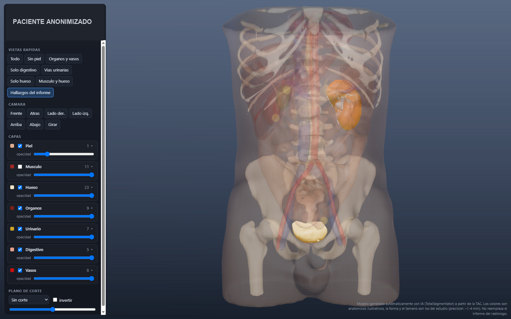
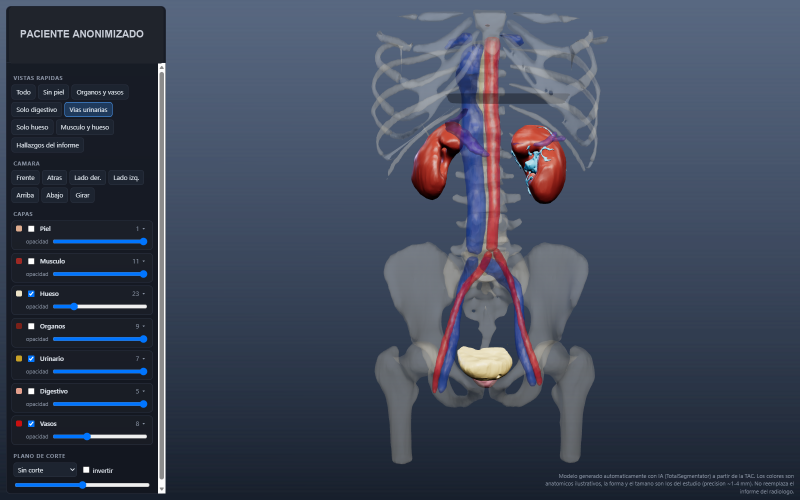
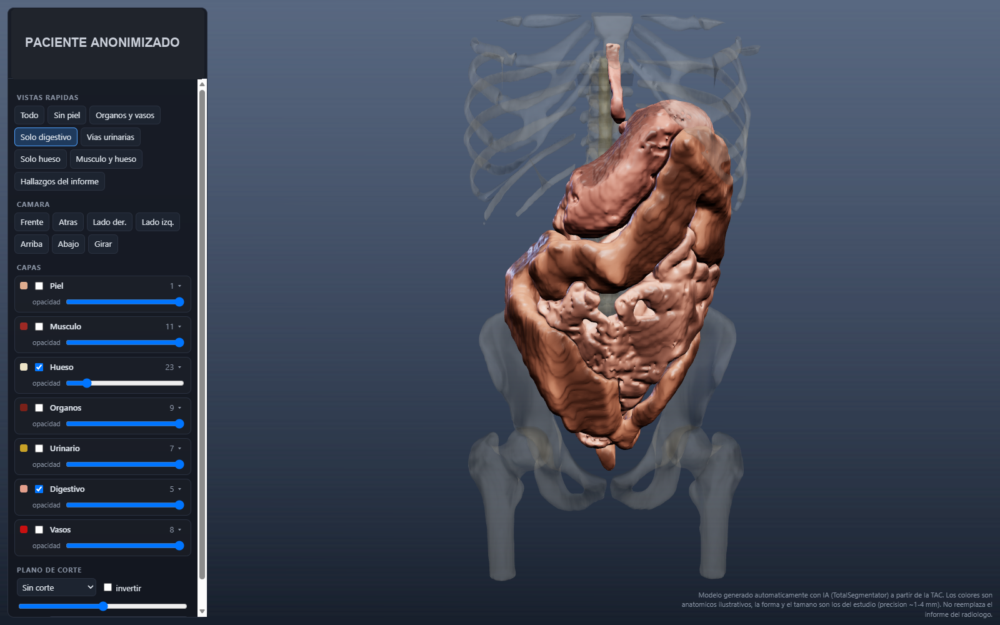
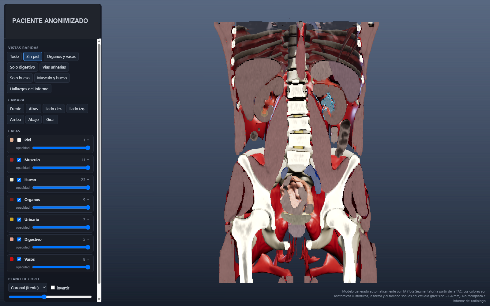
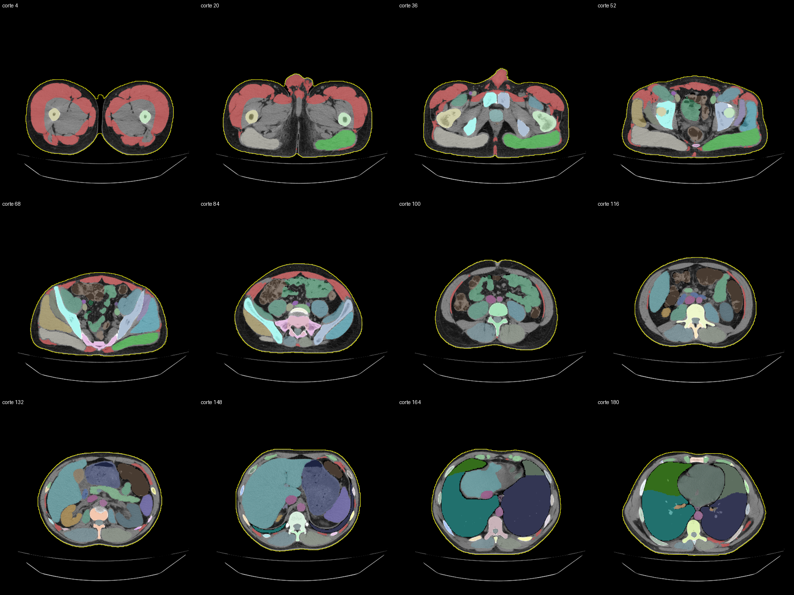

# TAC 3D

Aplicación de escritorio para Windows que convierte una tomografía (TAC) en un modelo 3D interactivo. Se importa el `.zip` con los DICOM del estudio, la IA segmenta órganos, huesos, músculos, vasos y hallazgos, y el resultado se revisa en un visor 3D con capas, vistas rápidas y planos de corte.

[](https://github.com/bvr218/TAC-3D/releases/download/v1.1.0/TAC3D_Instalador_1.1.0.exe)

- **Descarga directa del instalador:** [TAC3D_Instalador_1.1.0.exe](https://github.com/bvr218/TAC-3D/releases/download/v1.1.0/TAC3D_Instalador_1.1.0.exe) (~162 MB)
- **Todas las versiones:** [Releases](https://github.com/bvr218/TAC-3D/releases/latest)

> Herramienta de apoyo visual. Los modelos se generan automáticamente con IA y **no reemplazan el informe del radiólogo**.

## Capturas

Los datos del paciente están tapados en todas las imágenes.

| Hallazgos del informe | Vías urinarias |
|---|---|
|  |  |

| Aparato digestivo | Plano de corte coronal |
|---|---|
|  |  |

Imágenes de control de la segmentación (cortes axiales):



## Instalación

1. Descarga [TAC3D_Instalador_1.1.0.exe](https://github.com/bvr218/TAC-3D/releases/download/v1.1.0/TAC3D_Instalador_1.1.0.exe).
2. Ejecútalo. No necesita permisos de administrador; se instala en `%LOCALAPPDATA%\Programs\TAC 3D`. Si Windows SmartScreen avisa, pulsa *Más información → Ejecutar de todas formas* (el instalador no está firmado).
3. Abre **TAC 3D** y ve a la página **Equipo y motor**: comprueba los requisitos y pulsa **Instalar motor de IA**. Este paso pide permisos de administrador: Windows mostrará el aviso de control de cuentas (UAC) y TAC 3D se volverá a abrir como administrador para continuar la instalación. La primera vez descarga PyTorch, TotalSegmentator y los modelos (unos 7-10 GB), por lo que hace falta internet.
4. Pulsa **Agregar estudio** (o arrastra el `.zip` del TAC a la ventana). La app valida el estudio, elige la mejor serie y lo pone en la cola de procesamiento.
5. Al terminar, abre el estudio en el visor 3D.

### Requisitos

| | Mínimo | Recomendado |
|---|---|---|
| Sistema | Windows 10/11 de 64 bits | |
| RAM | 8 GB | 16 GB |
| Procesador | 4 núcleos | 8 núcleos o más |
| GPU | Opcional | NVIDIA con 4 GB de VRAM y controlador 528 o superior |
| Disco | ~15 GB para el motor y los modelos | + 1-2 GB por estudio |

Con GPU NVIDIA un estudio tarda unos 25 minutos; solo con procesador, de 1 a 3 horas. La app aprende los tiempos reales del equipo para mejorar la estimación.

## Qué hace

- **Importación:** lee `.zip` o carpetas DICOM, detecta las series útiles, convierte a NIfTI y guarda el informe del radiólogo si viene incluido.
- **Segmentación con IA** ([TotalSegmentator](https://github.com/wasserth/TotalSegmentator) / nnU-Net): órganos, huesos, vértebras y discos, músculos de la pared, vasos pulmonares y hepáticos, segmentos del hígado, nódulos pulmonares, lesiones hepáticas y derrame pleural/pericárdico. Los modelos que no aplican al estudio se omiten.
- **Análisis adicional:** piel y pared muscular, contenido intestinal, zonas de densidad distinta dentro de los órganos, detección de candidatos a cálculo (en estudios sin contraste) y líquido en pelvis renal.
- **Modelos 3D:** mallas suavizadas exportadas a STL (para impresión 3D) y GLB (para el visor web).
- **Visor 3D** (three.js): capas con opacidad, vistas rápidas (sin piel, órganos y vasos, digestivo, vías urinarias, hueso, hallazgos), cámaras predefinidas y planos de corte axial/coronal/sagital.
- **Hallazgos:** `hallazgos.json` por estudio permite anotar estructuras o crear nuevas a partir de cálculos detectados y regenerar los modelos.

## Estructura

```
app/        Aplicación de escritorio (PySide6): ventana, cola de trabajos, validación, instalación del motor
  empaquetar/  PyInstaller + Inno Setup para generar el instalador
pipeline/   Procesamiento: DICOM -> NIfTI -> segmentación -> mallas -> imágenes de control
visor/      Visor 3D web (three.js)
```

## Desarrollo

Ejecutar desde el código:

```powershell
python -m venv .venv
.venv\Scripts\pip install PySide6 pydicom psutil numpy
.venv\Scripts\python app\main.py
```

El motor de IA se instala desde la propia app (usa [uv](https://github.com/astral-sh/uv)). Para desarrollo, coloca `uv.exe` en `app\herramientas\`.

Uso del pipeline por línea de comandos (con el entorno del motor):

```powershell
python pipeline\importar.py Study-XXXX.zip               # importa un estudio nuevo
python pipeline\importar.py Study-XXXX.zip --serie "8"   # fuerza una serie concreta
python pipeline\importar.py --rehacer <id>               # regenera mallas tras editar hallazgos.json
```

### Generar el instalador

Requiere Python con `PySide6 pyinstaller pydicom psutil numpy` en `%LOCALAPPDATA%\tac3d_build`, `uv.exe` en `app\herramientas\` e [Inno Setup 6](https://jrsoftware.org/isinfo.php):

```powershell
powershell -ExecutionPolicy Bypass -File app\empaquetar\compilar.ps1
```

El instalador queda en `instalador\TAC3D_Instalador_<versión>.exe`.

## Privacidad

Todo el procesamiento es local; ningún estudio sale del equipo. Este repositorio no contiene datos de pacientes.
